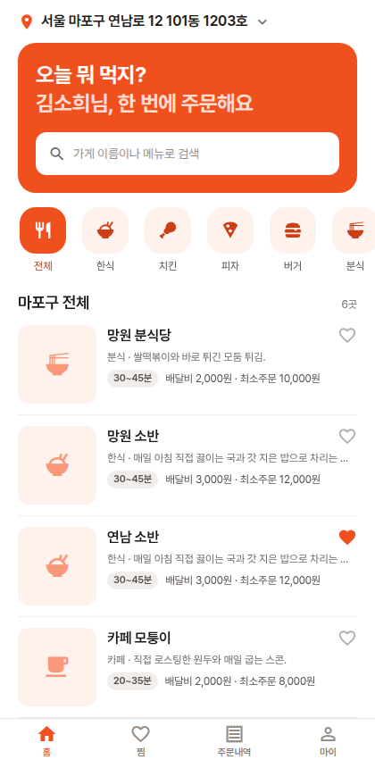
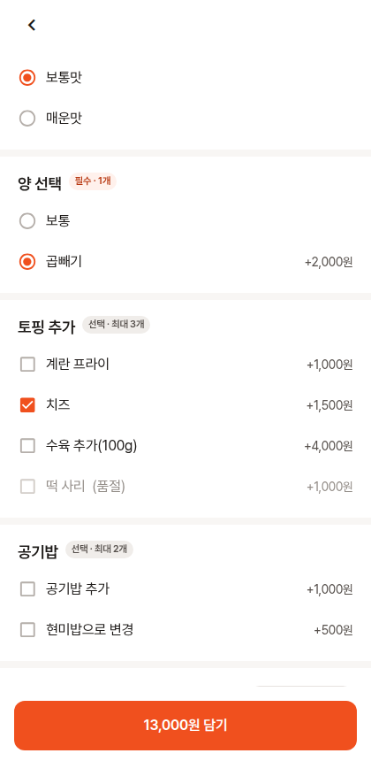
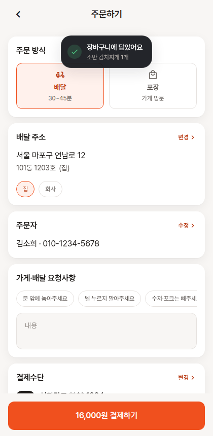
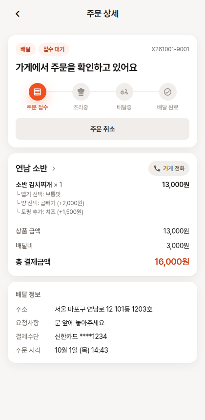

<p align="center">
  
</p>
<h1 align="center">Xoeat</h1>
<p align="center">배달 플랫폼의 <b>구매자 앱</b>. 가게를 고르고, 옵션을 골라 담고, 결제하고, 주문 상태를 실시간으로 확인합니다.<br>React Native(Expo) 한 코드베이스로 iOS · Android · Web 에서 동작합니다.</p>

<p align="center">
  
  
  
  
</p>

<!-- 배포 후 채우기: 웹 데모 URL -->

사장님 앱 [xoeat-partner](https://github.com/xoheeoh/xoeat-partner) 와 **같은 Supabase 프로젝트**를 씁니다.
이 앱에서 넣은 주문은 사장님 앱의 접수대기 목록에 알림음과 함께 바로 뜨고, 사장님이 수락·조리·배달 처리를 하면
이 앱의 주문 상세가 실시간으로 바뀝니다. 두 앱을 나란히 띄워 놓으면 주문의 양쪽 끝을 한 번에 볼 수 있습니다.

## 데모 계정

| 아이디 | 비밀번호 | 비고 |
| --- | --- | --- |
| `user01` | `demo1234!` | 배송지 2개 · 카드 2장 · 찜 2곳 · 지난 주문 6건 · 진행중 주문 1건 |
| `user02` | `demo1234!` | 다른 사람이 `user01` 을 쓰고 있을 때 |

회원가입도 실제로 동작합니다 (아이디·비밀번호·이름·휴대폰, 이메일 인증 없음). 데모 데이터는 예고 없이 초기화될 수 있습니다.

> 결제는 모의 결제입니다. 카드 등록은 번호 형식(Luhn)만 검사하고 끝 4자리만 저장하며, 실제 승인은 일어나지 않습니다.
> 테스트 카드번호: `4242 4242 4242 4242`

---

## 3분 둘러보기

1. **홈** — `user01` 로 로그인. 기본 배송지(마포구)와 카테고리별 가게 6곳이 보입니다. 하트를 눌러 찜.
2. **가게 → 메뉴** — "연남 소반" › "소반 김치찌개". 맵기·양은 필수(라디오), 토핑은 최대 3개 선택(체크). 품절 옵션은 눌리지 않습니다.
   담으면 하단에 장바구니 바가 뜹니다. 다른 가게 메뉴를 담으면 "비우고 담기"를 묻습니다.
3. **주문하기** — 배달/포장 선택, 배송지·결제수단 변경, 요청사항 프리셋. 배달 최소주문금액에 모자라면 버튼이 막힙니다.
   `결제하기` → Xoeat Pay 모의 결제창 → 승인 → 주문 완료.
4. **주문 상태** — 주문 상세의 트래커(접수 → 조리중 → 배달중 → 완료). 사장님 앱(`owner01`)에서 같은 주문을 수락하면
   이 화면이 Realtime 으로 바뀌고 토스트가 뜹니다. 접수대기 중에는 구매자가 직접 취소할 수 있습니다.
5. **마이페이지** — 배송지 추가·기본 설정, 카드 등록(가상)·기본 결제수단, 찜한 가게, 지난 주문 재주문.

---

## 구조

```
xoeat-customer/
  App.tsx                       네비게이션(native-stack + bottom-tabs) · 전역 프로바이더 · 폰트 로딩
  src/screens/
    Auth/                       로그인 · 회원가입
    Home/                       홈(주소 · 검색 · 카테고리 · 가게 목록) · 찜한 가게
    Store/                      가게 상세(메뉴 · 가게 정보) · 메뉴 상세(옵션 · 수량 · 담기)
    Cart/                       장바구니 · 주문하기(모의 결제) · 주문 완료
    Orders/                     주문내역(진행중/지난 · 재주문) · 주문 상세(상태 트래커 · 취소)
    MyPage/                     마이페이지 · 배송지 · 결제수단 · 내 정보
  src/components/common/        디자인 시스템 (xoeat-partner 와 같은 컴포넌트·토큰)
  src/components/store/         StoreCard · MenuRow
  src/svc/apis/                 어댑터 — client(응답 계약 · 오류 문구) · customerApi · catalogApi · orderApi
  src/svc/contexts/             Session(회원 · 찜) · Cart(장바구니, 기기 저장) · Dialog · Loading
  src/svc/data/constants.ts     카테고리 · 주문 상태 문구 · 카드사 · 요청사항 프리셋
  src/styles/                   디자인 토큰
  docs/screenshots/             README 용 화면
```

백엔드(스키마 · RLS · RPC · 데모 시드)는 [xoeat-partner/supabase](https://github.com/xoheeoh/xoeat-partner/tree/main/supabase) 에 있고,
구매자 쪽 명세는 [xoeat-partner/docs/api-spec.md](https://github.com/xoheeoh/xoeat-partner/blob/main/docs/api-spec.md) 의 "구매자" 절입니다.

### 기술 선택

| 영역 | 선택 | 이유 |
| --- | --- | --- |
| 프레임워크 | Expo (managed) | iOS · Android · Web 한 코드베이스. 링크로 바로 볼 수 있는 웹 데모 |
| 백엔드 | 사장님 앱과 같은 Supabase 프로젝트 | 주문이 두 앱을 실제로 오가야 데모가 된다. 역할은 RLS 로 나눈다 (가게 소유자 / 회원) |
| 주문 생성 | RPC `place_order` | 앱은 메뉴 id·수량·옵션 id 만 보내고, 가격·옵션 규칙·최소주문·영업 상태는 서버가 다시 계산·검증 |
| 실시간 | Supabase Realtime | 내 주문 UPDATE 를 구독해 상태 트래커와 목록을 갱신 |
| 장바구니 | Context + AsyncStorage | 한 번에 한 가게. 앱을 껐다 켜도 남고, 주문 완료·로그아웃 시 비운다 |
| 결제 | 모의 결제창 (시트) | 실제 PG 는 사업자 심사가 필요. 승인 흐름(요청 → 진행 → 승인)만 재현 |
| 스타일 | `StyleSheet` + 디자인 토큰 | 사장님 앱과 같은 토큰·컴포넌트를 써서 두 앱의 룩을 맞춘다 |

### 지킨 원칙

**금액은 서버가 정한다.** 장바구니 합계는 표시용이고, 결제 금액은 `place_order` 가 메뉴·옵션 가격을 다시 읽어 계산한다.
앱이 가격을 바꿔 보내도 소용없고, 품절·숨김·옵션 규칙 위반은 서버가 오류 코드로 거절한다.

**한 번에 한 가게.** 다른 가게 메뉴를 담으면 바꿀지 묻는다. 주문 단위가 가게이므로 장바구니도 가게 단위다.

**상태는 밀어 준다.** 주문 후 앱을 보고 있으면 사장님의 처리가 토스트와 트래커로 바로 나타난다. 폴링은 없다.

**오류는 코드로 받고, 문구는 앱이 정한다.** `OPTION_REQUIRED`, `MIN_ORDER_AMOUNT`, `STORE_PAUSED` 같은 코드를
`svc/apis/client.ts` 한 곳에서 사용자 문구로 바꾼다.

---

## 범위

이 저장소에서 작성한 것은 앱 전체입니다 — 화면 16개, 장바구니·주문 흐름, Realtime 상태 추적, 회원·배송지·결제수단 관리.

백엔드는 사장님 앱 저장소의 `supabase/` 에 **데모용 API 서버**로 함께 있습니다. 실무에서는 백엔드 팀이 명세와 함께 제공하는 영역이며,
이 프로젝트에서는 그 역할을 대신할 서버를 AI 도구로 생성해 사용했습니다. 앱은 명세만을 기준으로 연동했습니다.

**데모 범위 밖으로 둔 것.**

- 위치 기반 가게 탐색 (GPS · 지도 · 우편번호 검색) — 배송지는 직접 입력, 가게 목록은 마포구 고정
- 실제 결제 (PG) · 쿠폰 · 포인트
- 리뷰 · 별점 · 배달 기사 위치
- 푸시 알림 — 앱이 켜져 있을 때의 Realtime 알림만

---

## 직접 실행하기

1. 먼저 [xoeat-partner](https://github.com/xoheeoh/xoeat-partner) 의 "직접 실행하기"대로 Supabase 프로젝트를 올리고 `npm run seed:demo` 까지 합니다.
   (이 때 가게 6곳과 회원 `user01`·`user02` 가 함께 만들어집니다.)
2. 이 저장소에서:

```bash
cp .env.example .env            # 같은 프로젝트의 URL, anon key
npm install
npm run web                     # 또는 npm run ios / npm run android
```

두 앱을 같이 보려면 다른 포트로 사장님 앱도 띄웁니다: `cd ../xoeat-partner/apps/mobile && npx expo start --web --port 8082`.
